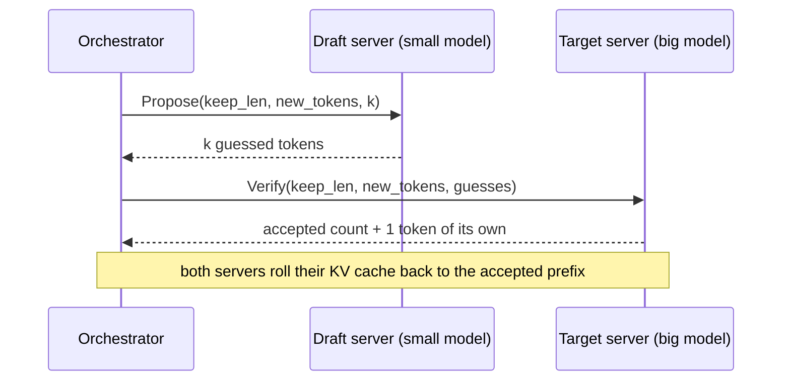
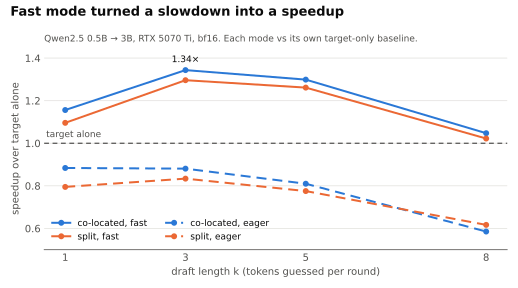
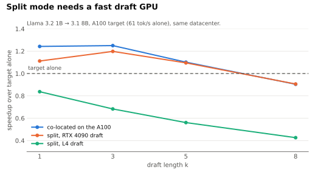
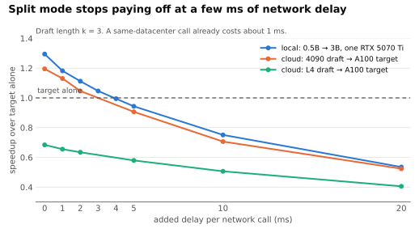
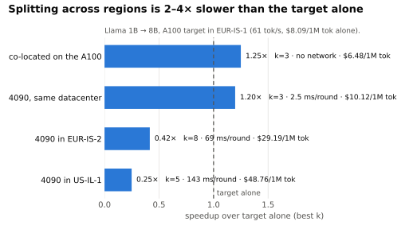

# specwire

[](https://github.com/arulster17/specwire/actions/workflows/ci.yml)

Speculative decoding with the draft model and the target model on **separate
machines**, talking over gRPC, and a benchmark of when that actually pays off.

> **Built off [SpecSplit](https://github.com/SamvritS/SpecSplit).** specwire is my
> rebuild and continuation of SpecSplit, a group project I was part of. SpecSplit
> built the disaggregated design but couldn't measure it: its benchmarks ran through
> ngrok tunnels at 1–2 tokens/s, with about 99.9% of the time spent waiting on the
> network, and it had no target-only baseline to compare against. specwire rebuilds
> the core from scratch and answers the question. Credit for the original idea and
> design goes to the SpecSplit authors.

## The short answer

Splitting the draft off the target's GPU **works, but only inside one datacenter and
only with a fast draft GPU**. Even then, with one request at a time, it ties
running both models on the same GPU and costs more per token.

| Llama 3.2 1B → Llama 3.1 8B, A100 target | tok/s | vs target alone | $ / 1M tokens |
|---|---|---|---|
| Target alone | 61.4 | 1.00× | $8.09 |
| Draft co-located on the A100 (k=3) | 76.8 | **1.25×** | **$6.48** |
| Split: RTX 4090 draft, same datacenter (k=3) | 73.6 | **1.20×** | $10.12 |
| Split: L4 draft, same datacenter (k=1) | 51.4 | 0.84× | $12.85 |
| Split: 4090 draft in EUR-IS-2, 68 ms network/round (k=8) | 25.5 | 0.42× | $29.19 |
| Split: 4090 draft in US-IL-1, 143 ms network/round (k=5) | 15.3 | 0.25× | $48.76 |

- **Break-even network delay:** about 3 ms added per call (two calls per round). Inside
  one datacenter the network costs about 2.5 ms per round, so there is room; the other
  regions tested cost 68 and 143 ms per round.
- **Draft speed decides split mode.** The L4 drafts 2.7× slower than the 4090 (12.3 vs
  4.6 ms per token), and the A100 sits idle waiting for it.
- **Memory freed is small at this size:** moving a 1B draft off the A100 frees 2.6 GB
  of 80. That only matters if it lets the target serve more requests at once, which
  these single-request benchmarks don't test.
- **Exactness:** greedy output matches the target alone token for token (tested in
  fp32 in eager mode, fast mode and over gRPC); sampled output is distributed exactly
  as the target's (rejection sampling, with a statistical test).

All numbers: bf16, 4 prompts × 128 tokens, median of 3 runs after a warmup, RunPod
EUR-IS-1, October 2026. Raw results are in [`results/`](results).

## How one round works



The target checks all k guesses in **one** forward pass, so each round yields between
1 and k+1 tokens for one target call. Each request carries `keep_len` (how much of
the worker's KV cache is still valid) and the tokens it hasn't seen yet, so a worker
never has to guess what the orchestrator kept.

## Results

### Making the draft cheap enough to be worth it

<picture>
  <source media="(prefers-color-scheme: dark)" srcset="docs/figures/fast-mode-dark.svg">
  
</picture>

The first honest benchmark was a loss: every speculative setup was *slower* than the
target alone (0.88× at best). A 0.5B draft step cost 70% as much as a 3B target step,
because both were dominated by Python and kernel-launch overhead, not by the model.

**Fast mode** fixes that with a preallocated static KV cache plus CUDA graphs:

- **Static cache, O(1) rollback.** Rejected guesses are discarded by moving a length
  pointer back; stale entries are masked out and overwritten next round.
- **CUDA graphs.** Each input length (1 token for drafting, k+1 for verifying) is
  captured once and replayed with one launch. The draft step drops from 14 ms to
  4.5 ms.
- **The target-only baseline gets the same treatment,** so every speedup is measured
  against an equally optimized baseline.
- **One trap worth knowing:** transformers' `StaticCache` ignores the `cache_position`
  you pass and writes at its own on-GPU counter, which the graph advances on every
  replay. Rollback has to reset that counter too, or keys land where the attention
  mask can't see them ([`specwire/fast.py`](specwire/fast.py)).

### The draft GPU matters more than the network

<picture>
  <source media="(prefers-color-scheme: dark)" srcset="docs/figures/a100-k-dark.svg">
  
</picture>

### Where splitting stops paying off

<picture>
  <source media="(prefers-color-scheme: dark)" srcset="docs/figures/delay-dark.svg">
  
</picture>

Delay is injected per gRPC call, on top of the real network. Every round makes two
calls (propose, then verify), so 3 ms per call adds about 6 ms per round.

### Real distance

<picture>
  <source media="(prefers-color-scheme: dark)" srcset="docs/figures/regions-dark.svg">
  
</picture>

Longer drafts help a little at high latency (the best k moves from 3 to 5–8, since
each round trip then buys more tokens), but acceptance caps how far that goes.
RunPod's datacenter names don't tell you distance: EUR-IS-2 measured 68 ms from
EUR-IS-1.

## Compared with SpecSplit

| | SpecSplit | specwire |
|---|---|---|
| Draft shape | token trees, tree-attention verify | chains |
| Overlap draft and verify | yes | no |
| Target-only and co-located baselines | none | both, equally optimized |
| Throughput measured | ~1–2 tok/s (ngrok) | up to 106 tok/s |
| Static KV cache with O(1) rollback | target only | both workers |
| CUDA graphs | no | yes (3× faster draft step) |
| Output proven equal to target alone | unit tests on verification | end-to-end, token for token |
| Multi-machine runs | over ngrok tunnels | RunPod, 3 datacenters, with $/1M tokens |

## Run it

Needs Python 3.12 and [uv](https://docs.astral.sh/uv/). On Linux and Windows `uv sync`
installs CUDA 13 PyTorch.

```sh
uv sync
uv run pytest                     # 88 tests; CUDA ones are skipped without a GPU
```

Benchmark on one machine (split mode starts both gRPC servers as local subprocesses):

```sh
uv run python -m specwire.bench --fast --modes target colocated split --k 1 3 5 8 \
    --draft-model Qwen/Qwen2.5-0.5B --target-model Qwen/Qwen2.5-3B --out results/my-run.json
uv run python -m specwire.bench --fast --modes target split --k 3 --rtt-ms 0 1 2 5 10
```

Run the servers yourself and watch rounds as they happen:

```sh
uv run python -m specwire.rpc draft  --device cuda --dtype bfloat16 --fast
uv run python -m specwire.rpc target --device cuda --dtype bfloat16 --fast
uv run python -m specwire.run "Once upon a time," --k 3 --show-steps
```

Two-machine runs on RunPod (needs `RUNPOD_API_KEY` and a RunPod secret holding a
Hugging Face token; pods terminate themselves after `--ttl-min`):

```sh
uv run python -m specwire.cloud up --draft-gpu "NVIDIA GeForce RTX 4090"
uv run python -m specwire.cloud bench target -- --modes target colocated --k 1 3 5 8
uv run python -m specwire.cloud bench draft -- --modes split --k 1 3 5 8
uv run python -m specwire.cloud down
```

Redraw the charts from `results/` with `uv run python scripts/plots.py`.

## Layout

| Path | What it is |
|---|---|
| [`specwire/draft.py`](specwire/draft.py), [`target.py`](specwire/target.py) | the two workers |
| [`specwire/verify.py`](specwire/verify.py) | greedy acceptance and rejection sampling |
| [`specwire/orchestrator.py`](specwire/orchestrator.py) | the decode loop and cache bookkeeping |
| [`specwire/fast.py`](specwire/fast.py) | static KV cache + CUDA graph replay |
| [`specwire/rpc.py`](specwire/rpc.py), [`proto/`](specwire/proto/specwire.proto) | gRPC servers and clients, with a shared-token check |
| [`specwire/bench.py`](specwire/bench.py) | the benchmark harness |
| [`specwire/cloud.py`](specwire/cloud.py) | RunPod launcher: pods, SSH, teardown |
| [`results/`](results) | every benchmark run as JSON (`archive/` holds superseded ones) |
| [`docs/PLAN.md`](docs/PLAN.md) | the project plan and what's done |

## Limitations

- **One request at a time.** Batching many requests is the case where moving the draft
  off the target could pay off, and it isn't tested yet.
- **Small benchmark set:** 4 prompts, 128 tokens each, greedy. Acceptance rates depend
  on the text.
- **bf16 near-ties.** In bf16, speculative and target-only output occasionally pick
  different tokens where the top two are within ~0.15 in log-probability. In fp32 they
  match exactly, which is what the tests check.
- **Pinned to transformers 5.20.1**, because fast mode relies on `StaticCache`
  internals.
