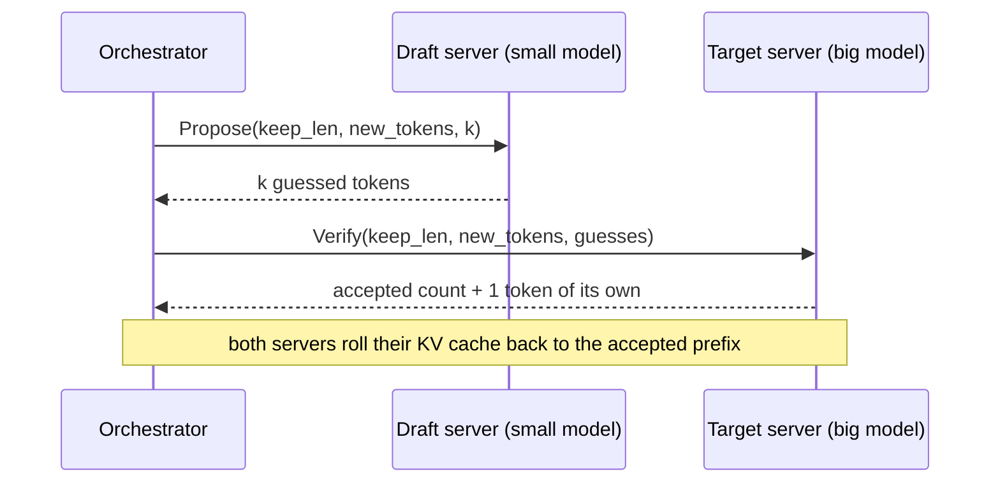
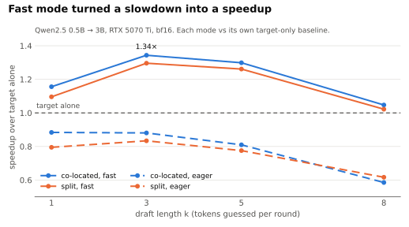
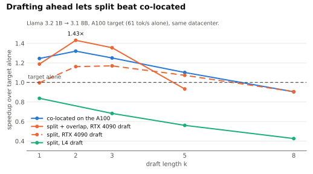
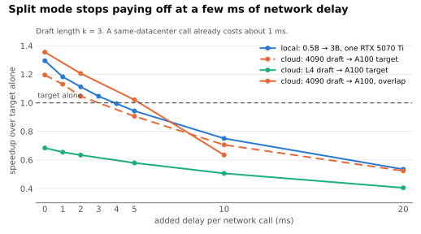
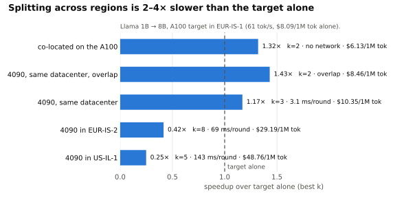

# SpecWire

[](https://github.com/arulster17/specwire/actions/workflows/ci.yml)

Speculative decoding with the draft model and the target model on **separate
machines**, talking over gRPC, and a benchmark of when that actually pays off.

> **Built off [SpecSplit](https://github.com/SamvritS/SpecSplit).** SpecWire is my
> rebuild and continuation of SpecSplit, a group project I was part of. SpecSplit
> built the disaggregated design but couldn't measure it: its benchmarks ran through
> ngrok tunnels at 1–2 tokens/s, with about 99.9% of the time spent waiting on the
> network, and it had no target-only baseline to compare against. SpecWire rebuilds
> the core from scratch and answers the question. Credit for the original idea and
> design goes to the SpecSplit authors.

## The short answer

Splitting the draft off the target's GPU **works, but only inside one datacenter and
only with a fast draft GPU**. On its own, split ties running both models on the same
GPU. With **overlap**, where the draft works on the next round while the target
checks this one, split becomes the fastest setup: **1.43×** against co-located's
1.32×. It still costs more per token, because you pay for a second GPU.

| Llama 3.2 1B → Llama 3.1 8B, A100 target | tok/s | vs target alone | $ / 1M tokens |
|---|---|---|---|
| Target alone | 61.5 | 1.00× | $8.09 |
| Draft co-located on the A100 (k=2) | 81.2 | 1.32× | **$6.13** |
| **Split + overlap: RTX 4090 draft, same datacenter (k=2)** | **88.0** | **1.43×** | $8.46 |
| Split: RTX 4090 draft, same datacenter (k=3) | 71.9 | 1.17× | $10.35 |
| Split: L4 draft, same datacenter (k=1) | 51.4 | 0.84× | $12.85 |
| Split: 4090 draft in EUR-IS-2, 68 ms network/round (k=8) | 25.5 | 0.42× | $29.19 |
| Split: 4090 draft in US-IL-1, 143 ms network/round (k=5) | 15.3 | 0.25× | $48.76 |

- **Break-even network delay:** about 3 ms added per call (two calls per round), or
  about 5 ms with overlap. Inside one datacenter the network costs about 2.5 ms per
  round, so there is room; the other regions tested cost 68 and 143 ms per round.
- **Overlap wins on speed, not on cost.** It cuts split's extra cost per token over
  co-located from 69% to 38% ($8.46 vs $6.13), but the second GPU still adds 50% to
  the hourly price.
- **Draft speed decides split mode.** The L4 drafts 2.7× slower than the 4090 (12.3 vs
  4.6 ms per token), and the A100 sits idle waiting for it.
- **Memory freed is small at this size:** moving a 1B draft off the A100 frees 2.6 GB
  of 80. That only matters if it lets the target serve more requests at once (see
  [Next](#next-many-users-at-once)).
- **Exactness:** greedy output matches the target alone token for token (tested in
  fp32 in eager mode, fast mode, with overlap and over gRPC); sampled output is distributed exactly
  as the target's (rejection sampling, with a statistical test).

All numbers: bf16, 4 prompts × 128 tokens, median of 3 runs after a warmup, RunPod
EUR-IS-1, October 2026. The first four rows come from one session with both pods up
at once; the rest are from earlier sessions on the same hardware (61.4 tok/s alone).
Raw results are in [`results/`](results).

## How one round works



The target checks all k guesses in **one** forward pass, so each round yields between
1 and k+1 tokens for one target call. Each request carries `keep_len` (how much of
the worker's KV cache is still valid) and the tokens it hasn't seen yet, so a worker
never has to guess what the orchestrator kept.

**Overlap** (`--overlap`) keeps the draft GPU busy while the target verifies. The
draft bets that all k guesses will be accepted and that the target's own next token
will be the one the draft would pick. On that bet, it drafts the next round in the
background. If the bet wins, the next round starts with its draft already done. If it
loses, the early draft is thrown away and the round is drafted as usual, so the output
never changes. The bet can only win when every guess is accepted; it won in 53% of
rounds at k=1, 38% at k=2 and 29% at k=3.

## Results

### Making the draft cheap enough to be worth it

<picture>
  <source media="(prefers-color-scheme: dark)" srcset="docs/figures/fast-mode-dark.svg">
  
</picture>

The first honest benchmark was a loss: every speculative setup was *slower* than the
target alone (0.88× at best). A 0.5B draft step cost 70% as much as a 3B target step,
because both were dominated by Python and kernel-launch overhead, not by the model.

**Fast mode** fixes that with a preallocated static KV cache plus CUDA graphs:

- **Static cache, O(1) rollback.** Rejected guesses are discarded by moving a length
  pointer back; stale entries are masked out and overwritten next round.
- **CUDA graphs.** Each input length (1 token for drafting, k+1 for verifying) is
  captured once and replayed with one launch. The draft step drops from 14 ms to
  4.5 ms.
- **The target-only baseline gets the same treatment,** so every speedup is measured
  against an equally optimized baseline.
- **One trap worth knowing:** transformers' `StaticCache` ignores the `cache_position`
  you pass and writes at its own on-GPU counter, which the graph advances on every
  replay. Rollback has to reset that counter too, or keys land where the attention
  mask can't see them ([`specwire/fast.py`](specwire/fast.py)).

### The draft GPU matters more than the network

<picture>
  <source media="(prefers-color-scheme: dark)" srcset="docs/figures/a100-k-dark.svg">
  
</picture>

With an L4 draft, split is slower than the target alone at every k: the L4 drafts
2.7× slower than the 4090, and the A100 waits on it. With the 4090, plain split comes
close to co-located, and overlap puts it ahead at k = 2 and 3. Overlap is best at
small k. At k=5 the bet rarely wins (15% of rounds), and the 6-token early draft takes
longer than the target's check, so every lost bet makes the next round wait for a
draft that gets thrown away.

### Where splitting stops paying off

<picture>
  <source media="(prefers-color-scheme: dark)" srcset="docs/figures/delay-dark.svg">
  
</picture>

Delay is injected per gRPC call, on top of the real network. Every round makes two
calls (propose, then verify), so 3 ms per call adds about 6 ms per round. Overlap
hides the draft's share of that delay in the rounds where its bet wins, which moves
the break-even from about 3 ms to about 5 ms. By 10 ms it no longer helps, since most
rounds still pay the full delay.

### Real distance

<picture>
  <source media="(prefers-color-scheme: dark)" srcset="docs/figures/regions-dark.svg">
  
</picture>

Longer drafts help a little at high latency (the best k moves from 3 to 5–8, since
each round trip then buys more tokens), but acceptance caps how far that goes.
RunPod's datacenter names don't tell you distance: EUR-IS-2 cost 68 ms of network
per round from EUR-IS-1.

## Next: many users at once

Everything above serves one request at a time. With many users batched together, the
target GPU becomes the bottleneck, and that is where moving the draft off it could pay
off. Before building batched decoding, I timed graph-replayed decode steps at batch
sizes 1–128 on the A100 and the 4090 ([`scripts/batchbench.py`](scripts/batchbench.py))
and combined them with the acceptance and network numbers above. **This is a
prediction, not a measurement:**

| Users at once | Co-located | Split | Split, two alternating groups |
|---|---|---|---|
| 1 | 1.35× | 1.22× | – |
| 16 | 1.36× | 1.30× | 1.32× |
| 32 | 1.36× | 1.28× | **1.50×** |
| 64 | 1.23× | 1.19× | **1.43×** |
| 128 | 1.14× | 1.13× | **1.42×** |

Co-located's gain fades as users grow, because drafting takes time away from
verifying on the A100. Split with two groups keeps the A100 busy: it verifies one half
of the users while the 4090 drafts for the other. Even so, co-located stays cheaper
per token at every batch size, since the second GPU adds 50% to the hourly cost. The
model assumes every user accepts the same number of tokens each round. For a single
user it predicted co-located about 8% higher than measured, so treat these as upper
bounds. The prediction doesn't include overlap. Batched decoding is being built next
to measure it for real.

## Compared with SpecSplit

| | SpecSplit | SpecWire |
|---|---|---|
| Draft shape | token trees, tree-attention verify | chains |
| Overlap draft and verify | yes | yes, measured: 1.17× → 1.43× |
| Target-only and co-located baselines | none | both, equally optimized |
| Throughput measured | ~1–2 tok/s (ngrok) | up to 106 tok/s |
| Static KV cache with O(1) rollback | target only | both workers |
| CUDA graphs | no | yes (3× faster draft step) |
| Output proven equal to target alone | unit tests on verification | end-to-end, token for token |
| Multi-machine runs | over ngrok tunnels | RunPod, 3 datacenters, with $/1M tokens |

## Run it

Needs Python 3.12 and [uv](https://docs.astral.sh/uv/). On Linux and Windows `uv sync`
installs CUDA 13 PyTorch.

```sh
uv sync
uv run pytest                     # 101 tests; CUDA ones are skipped without a GPU
```

Benchmark on one machine (split mode starts both gRPC servers as local subprocesses):

```sh
uv run python -m specwire.bench --fast --modes target colocated split --k 1 3 5 8 \
    --draft-model Qwen/Qwen2.5-0.5B --target-model Qwen/Qwen2.5-3B --out results/my-run.json
uv run python -m specwire.bench --fast --modes target split --k 3 --rtt-ms 0 1 2 5 10
```

Run the servers yourself and watch rounds as they happen:

```sh
uv run python -m specwire.rpc draft  --device cuda --dtype bfloat16 --fast
uv run python -m specwire.rpc target --device cuda --dtype bfloat16 --fast
uv run python -m specwire.run "Once upon a time," --k 3 --show-steps --overlap
```

Two-machine runs on RunPod (needs `RUNPOD_API_KEY` and a RunPod secret holding a
Hugging Face token; pods terminate themselves after `--ttl-min`):

```sh
uv run python -m specwire.cloud up --draft-gpu "NVIDIA GeForce RTX 4090"
uv run python -m specwire.cloud bench target -- --modes target colocated --k 1 3 5 8
uv run python -m specwire.cloud bench draft -- --modes split --k 1 2 3 5 --overlap both
uv run python -m specwire.cloud down
```

Redraw the charts from `results/` with `uv run python scripts/plots.py`.

## Layout

| Path | What it is |
|---|---|
| [`specwire/draft.py`](specwire/draft.py), [`target.py`](specwire/target.py) | the two workers |
| [`specwire/verify.py`](specwire/verify.py) | greedy acceptance and rejection sampling |
| [`specwire/orchestrator.py`](specwire/orchestrator.py) | the decode loop and cache bookkeeping |
| [`specwire/fast.py`](specwire/fast.py) | static KV cache + CUDA graph replay |
| [`specwire/rpc.py`](specwire/rpc.py), [`proto/`](specwire/proto/specwire.proto) | gRPC servers and clients, with a shared-token check |
| [`specwire/bench.py`](specwire/bench.py) | the benchmark harness |
| [`specwire/cloud.py`](specwire/cloud.py) | RunPod launcher: pods, SSH, teardown |
| [`scripts/`](scripts) | chart drawing and the batch-size microbenchmark |
| [`results/`](results) | every benchmark run as JSON, indexed in its [README](results/README.md) |
| [`docs/PLAN.md`](docs/PLAN.md) | the project plan and what's done |

## Limitations

- **One request at a time.** The batched numbers above are predicted from step
  timings, not measured end to end yet.
- **Overlap needs separate GPUs.** On one GPU the early draft competes with the
  target's check, so the bench only offers it in split mode.
- **Small benchmark set:** 4 prompts, 128 tokens each, greedy. Acceptance rates depend
  on the text.
- **bf16 near-ties.** In bf16, speculative and target-only output occasionally pick
  different tokens where the top two are within ~0.15 in log-probability. In fp32 they
  match exactly, which is what the tests check.
- **Pinned to transformers 5.20.1**, because fast mode relies on `StaticCache`
  internals.

## License

MIT, like SpecSplit. See [LICENSE](LICENSE).
